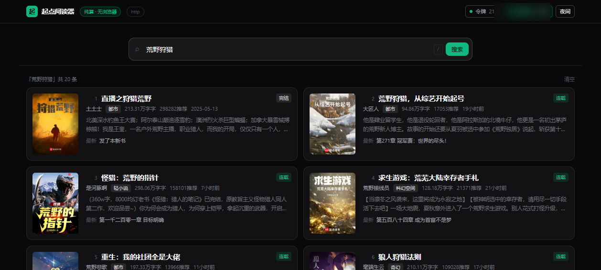
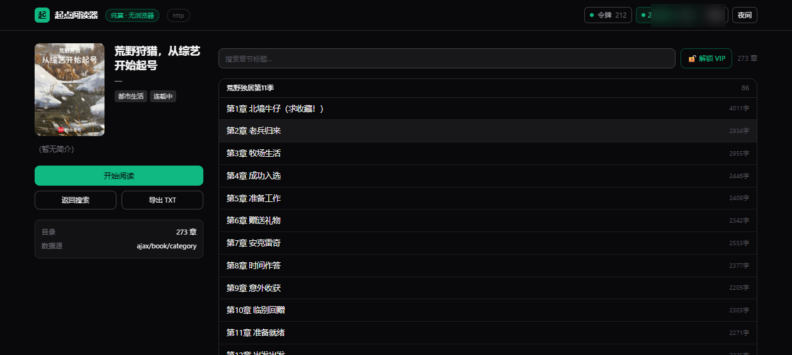

<p align="center">
  简体中文 · <a href="./README_EN.md">English</a>
</p>

<!-- README_SYNC: source=working-tree; updated=2026-11-18 -->

# 起点阅读器

起点中文网的 Windows 桌面客户端：不启动浏览器、不开放端口，登录、搜索、目录、正文全部走纯协议。

如果它对你有用，点一个 Star 收藏一下，方便以后回来，也让更多有同样需求的人找到它。问题、建议或新的书源规则，直接提 Issue。

[](https://github.com/a634691481-arch/qidian-reader/stargazers)
[](https://github.com/a634691481-arch/qidian-reader/blob/main/package.json)
[](https://tauri.app)
[](https://vuejs.org)
[](https://github.com/a634691481-arch/qidian-reader)
[](https://github.com/a634691481-arch/qidian-reader/commits/main)
[](https://github.com/a634691481-arch/qidian-reader/issues)

| 搜索 | 目录 |
| --- | --- |
|  |  |

## 这个项目解决什么问题

起点网页本身就能读，所以要先回答"为什么还要一个客户端"。

一是干净。浏览器自动化方案（Playwright / CDP）至少要常驻一个 Chromium，再把结果回传给脚本。这个项目是一个 Tauri 窗口加一个 Python 子进程，跑完就退出，没有浏览器、没有调试端口、没有代理服务。

二是诚实。起点的未购买 VIP 章只下发试读片段，如果客户端把 133 字当正文渲染，读者要翻到末尾才发现被骗。这里会先判定"付费墙 / 已下发比例 / 是否残缺"，把结果直接摆在目录和正文上。

## 和浏览器自动化比

| | 浏览器自动化 | 本项目 |
| --- | --- | --- |
| 运行时 | Chromium + Playwright/CDP | Tauri 窗口 + Python 子进程 |
| 令牌来源 | 在真实页面里执行 JS | 同一份 `probev3.js` 在 V8 里执行 |
| 前后端通信 | 本地 HTTP 或调试端口 | Tauri IPC + stdin/stdout |
| 正文残缺 | 一般直接展示 | 判定比例，残缺才回落外部源 |
| 登录 | 手动导 Cookie | 微信扫码，协议直连 |

## 快速开始

Windows 10/11。需要 Python 3、Node 18+、Rust stable（本次构建使用 Node 24.11、Rust 1.99、Python 3.13）。

```bash
pip install requests py_mini_racer opencv-python-headless numpy qrcode
npm install
npm run desktop
```

`npm run desktop` 会先释放 5174 端口，再启动 Vite，最后编译 Rust 并打开窗口；首次编译需要几分钟。

只想调 UI 时可以让前端跑在浏览器里（调试专用，生产链路并不经过它）：

```bash
python server/app.py
npm run dev
```

前端在 `127.0.0.1:5174`，HTTP 适配层在 `127.0.0.1:8788`。

跑测试：

```bash
python -m unittest discover -s tests -v
```

21 个用例全部离线执行，覆盖 HTML 解析、ID 消毒、参数钳制、原子写和 dispatch 收口。抓外部书源时如果想用 Chrome TLS 指纹，可以再装 `curl_cffi`；没装就自动退回 `requests`。

## 功能

- 搜索：书名/作者，分页加载，结果含封面、分类、字数、最新章节。
- 详情与目录：目录走官方 JSON 接口，按卷分组，章节可搜索，加载慢时有骨架屏。
- 阅读：正文分段落排版、沉浸模式、上一章/下一章、按书记住上次读到的位置。
- 扫码登录：微信原生 `qrconnect` 流程，二维码在本机生成，登录态写回 `data/cookie.txt`。
- 可读性探测：对 VIP 章逐章探测，标出"免费 / 已解锁 / 锁定"；两路并发，可随时停止。
- 导出 TXT：先取目录再分批抓正文，每批 6 章，前端显示进度，可取消。
- 主题：夜间 / 纸黄 / 日间三套语义色板。

快捷键：`/` 聚焦搜索，`←` `→` 翻章，`f` 沉浸模式，`t` 切换主题，`Esc` 返回目录。

## 架构

```text
Tauri window (webview)
   |  invoke('qidian', {cmd, params})        no port in production
   v
src-tauri/src/main.rs  long-lived child process + JSON line protocol
   v
server/core.py         command routing (COMMANDS table)
   |- qidian.py        search / catalog / detail / chapter / export
   |- login.py         WeChat QR login, pure protocol
   |- slider.py        gap locating + human-like drag trajectory
   |- parse.py         HTML -> data (pure functions, no IO)
   |- net.py           HTTP: inject w_tsfp / cookie / UA, retry
   |- tsfp.py          token minting (V8 runs probev3.js) + TTL cache
   |- mint.py          the V8 host shim around probev3.js
   |- paywall.py       paywall verdict / teaser ratio / completeness
   |- source_*.py      external book sources: backend + rules + registry
   |- store.py         cookie read/write (atomic)
   `- config.py        constants in one place
```

Rust 侧只做三件事：拉起子进程、按 `id` 匹配回包、超时后重建进程并重试一次。子进程崩溃不影响窗口；`server/core.py` 的 mtime 变化时下次调用会自动重启，改完后端不用重启整个应用。单条命令最长等待 600 秒（导出最重）。

`server/app.py` 只是给浏览器调试用的 HTTP 适配层，和 `core.py` 共用同一套业务函数。

## 令牌是怎么来的

起点校验 cookie 里的 `w_tsfp`。这个值由一段腾讯 Chaos VM 混淆的脚本在页面里算出，脚本会读 DOM、Canvas、navigator 和定时器，最后把结果写回 `document.cookie`。

做法是把起点自己的 `probev3.js` 放进 `py_mini_racer`（V8），再用一份手写垫片把 `document`、`navigator`、`localStorage`、`canvas.getContext`、`btoa/atob`、定时器补齐。脚本照常执行，写 cookie 的那一刻截获令牌。本地实测（2026-11-18，含进程启动）：

```bash
python server/mint.py data/seed.txt
# len=212  ~220ms
```

令牌是分钟级的，默认缓存 480 秒。只有 202/403/429 和网络错误才重铸，正常请求不会浪费这次计算。

## 付费墙与外部书源

未购买的 VIP 章，起点只给试读。用仓库里保存的真实章节页可以复现：

```text
chars=133  words=4040  ratio=0.033  vip=true  buy=false  price=20  teaser=true
```

`paywall.verdict()` 返回 `paid / ratio / incomplete`，命中付费墙或正文残缺时，才会去外部书源补全：

```text
chapter(bookId, chapterId)
  |- fetch SSR JSON from qidian, parse body + purchase state
  |- paywall.verdict(): paid / ratio / incomplete
  `- if paid or incomplete -> source_registry.resolve()
        |- search book by title in sources enabled in data/sources.json
        |- locate chapter by normalized title or by order
        |- fetch body, pass quality gate
        `- cache only near-complete chapters, read cache next time
```

质量闸：正文至少 300 字，且不低于全章字数的 30%（盗版站普遍只采到三到五成，宁可给半章并标 `truncated`）；只有达到全章 90% 才写缓存，避免把残缺锁死。返回体比官方多四个字段：`paid`、`ratio`、`fallback`、`source`。

书源是声明式的，`data/sources.json` 里写清 `searchUrl`、`itemSelector`、`chapterSelector`、`contentSelector` 和要剔除的节点，`enabled` 控制是否参与。默认文件里已启用两个源；站点会换域名和结构，接入新源后用自带脚本先自检：

```bash
python scripts/check-sources.py "荒野狩猎，从综艺开始起号"
```

`www` 被风控弹滑块时，请求会自动改走 `m.qidian.com`（实测同一时刻移动端仍是干净的），目录和正文都有对应的移动端解析。

## 一些实测结论

| 项 | 结论 |
| --- | --- |
| 风控闸门 | cookie `w_tsfp`，实测长度 212 字符，缺失即返回 202 空壳 |
| 生成方式 | `probev3.js` 在 V8 中执行，约 220ms，零网络请求 |
| 必要宿主垫片 | `document.cookie` 覆写、`btoa/atob`、`crypto.getRandomValues`、canvas/webgl 假上下文、navigator 指纹、定时器 |
| 有效期 | 分钟级，`TOKEN_TTL` 默认 480 秒 |
| 目录 | 官方 JSON：`GET /ajax/book/category?bookId=&_csrfToken=` |
| 搜索 / 正文 | 只有 SSR HTML，没有 JSON 接口 |
| 登录 | `qrconnect` 取 uuid → 长轮询 → `weixincallback` 取 alk → `sublogin` 换起点 cookie |

## 配置

| 环境变量 | 默认 | 说明 |
| --- | --- | --- |
| `TOKEN_TTL` | 480 | 令牌缓存秒数 |
| `QD_TIMEOUT` | 20 | 单请求超时 |
| `QD_DELAY` | 0.35 | 批量抓章节间隔 |
| `QD_MAX_EXPORT` | 80 | 导出章节上限 |
| `PORT` | 8788 | HTTP 调试端口 |
| `SOURCE_PROXY` | 空 | 外部书源代理；也接受 `HTTPS_PROXY` |

## 边界与风险

- 版权：目录和正文的版权属于阅文和作者。外部书源是第三方站点，内容来源和授权情况不由本项目控制，请不要把抓取结果再分发。
- 账号：自动化请求有触发风控的可能，登录态、限免资格都可能受影响。项目只保存你登录后自己的 cookie。
- 凭据：`data/cookie.txt` 是明文，只靠本机文件权限保护。`.gitignore` 已排除它，别手动提交。
- 用途：这个仓库的定位是研究客户端风控和协议实现。是否用它替代官方渠道，请自行判断平台条款和当地法律。

## 已知限制

- 只在 Windows 上验证过。端口清理脚本用 `netstat`/`taskkill`，打包目标是 NSIS。
- 发布版不会把 Python 和依赖打进安装包：可执行文件按所在目录找 `server/core.py`，需要本机 Python 环境。
- 测试只覆盖离线解析和参数收口，涉及网络的链路没有自动化测试。
- 外部书源随时可能失效，`data/sources.json` 里的状态会过期，以 `scripts/check-sources.py` 的实测为准。

## License

仓库目前没有 `LICENSE` 文件。没有许可证不等于可以随意使用，按默认版权规则作者保留权利。想复用代码请先开 Issue 说明用途，不要直接搬运。

---

如果这个项目解决了你的问题，点个 Star；想跟进改动可以 Watch Releases，遇到问题直接提 Issue。
