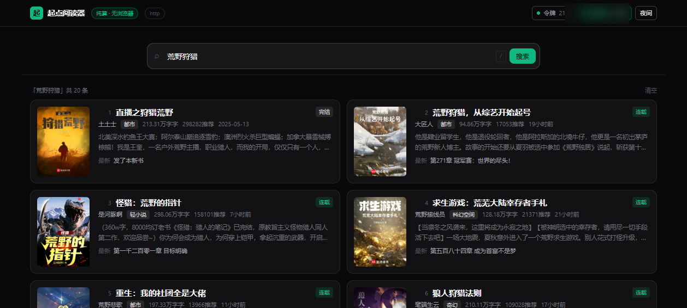
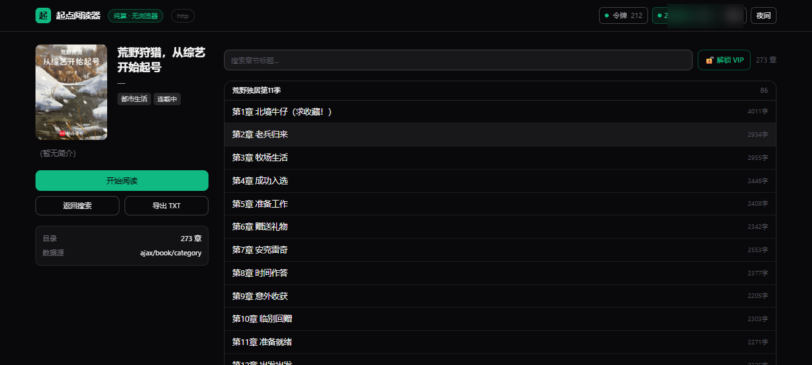

<p align="center">
  <a href="./README.md">简体中文</a> · English
</p>

<!-- README_SYNC: source=working-tree; updated=2026-11-18 -->

# Qidian Reader

A Windows desktop client for Qidian (起点中文网). No browser, no open port: login, search, catalog and chapter text all go through plain protocol calls.

If this solves a real problem for you, a Star makes it easy to come back and helps others with the same need find it. Bugs, ideas and new source rules are welcome in Issues.

[](https://github.com/a634691481-arch/qidian-reader/stargazers)
[](https://github.com/a634691481-arch/qidian-reader/blob/main/package.json)
[](https://tauri.app)
[](https://vuejs.org)
[](https://github.com/a634691481-arch/qidian-reader)
[](https://github.com/a634691481-arch/qidian-reader/commits/main)
[](https://github.com/a634691481-arch/qidian-reader/issues)

| Search | Catalog |
| --- | --- |
|  |  |

## Why this exists

Qidian already works in a browser, so "why a client?" needs an answer.

First, a smaller footprint. Browser automation (Playwright / CDP) keeps a Chromium alive and feeds results back to a script. This project is a Tauri window plus one Python child process: no browser, no debug port, no local proxy.

Second, honesty about paywalls. Qidian sends only a teaser for unpurchased VIP chapters. If a client renders those 133 characters as if they were the chapter, you only find out at the end. Here the app reports paid state and delivered ratio up front, on the catalog row and in the reader.

## Compared with browser automation

| | Browser automation | This project |
| --- | --- | --- |
| Runtime | Chromium + Playwright/CDP | Tauri window + Python child process |
| Token source | Execute JS in a real page | The same `probev3.js`, executed in V8 |
| UI/backend link | Local HTTP or debug port | Tauri IPC + stdin/stdout |
| Truncated body | Usually rendered as-is | Ratio checked, fallback only when incomplete |
| Login | Export cookies by hand | WeChat QR, direct protocol |

## Quick start

Windows 10/11. You need Python 3, Node 18+, and stable Rust (this build: Node 24.11, Rust 1.99, Python 3.13).

```bash
pip install requests py_mini_racer opencv-python-headless numpy qrcode
npm install
npm run desktop
```

`npm run desktop` frees port 5174, starts Vite, then compiles Rust and opens the window. The first build takes a few minutes.

To hack on the UI in a browser (debug only; production traffic does not go through it):

```bash
python server/app.py
npm run dev
```

The front end is on `127.0.0.1:5174`; the HTTP adapter is on `127.0.0.1:8788`.

Run the tests:

```bash
python -m unittest discover -s tests -v
```

All 21 cases run offline: HTML parsing, ID sanitizing, argument clamping, atomic writes, dispatch boundaries. Install `curl_cffi` if you want Chrome TLS impersonation when fetching external sources; without it the backend falls back to `requests`.

## Features

- Search by title or author, paged results with cover, category, word count and latest chapter.
- Book detail and catalog from the official JSON endpoint, grouped by volume, searchable, with skeleton loading.
- Reader with paragraph layout, immersive mode, previous/next chapter, and per-book resume position.
- WeChat QR login through the native `qrconnect` flow; the QR image is generated locally and the session is written to `data/cookie.txt`.
- Readability scan for VIP chapters, tagging each as free / rescued / locked. Two workers, cancellable.
- TXT export in batches of 6 chapters with progress and cancel.
- Three semantic themes: dark, sepia, light.

Shortcuts: `/` focuses search, `←` `→` change chapter, `f` toggles immersive mode, `t` cycles themes, `Esc` goes back to the catalog.

## Architecture

```text
Tauri window (webview)
   |  invoke('qidian', {cmd, params})        no port in production
   v
src-tauri/src/main.rs  long-lived child process + JSON line protocol
   v
server/core.py         command routing (COMMANDS table)
   |- qidian.py        search / catalog / detail / chapter / export
   |- login.py         WeChat QR login, pure protocol
   |- slider.py        gap locating + human-like drag trajectory
   |- parse.py         HTML -> data (pure functions, no IO)
   |- net.py           HTTP: inject w_tsfp / cookie / UA, retry
   |- tsfp.py          token minting (V8 runs probev3.js) + TTL cache
   |- mint.py          the V8 host shim around probev3.js
   |- paywall.py       paywall verdict / teaser ratio / completeness
   |- source_*.py      external book sources: backend + rules + registry
   |- store.py         cookie read/write (atomic)
   `- config.py        constants in one place
```

Rust only does three things: spawn the child, match responses by `id`, and rebuild plus retry once after a timeout. A dead kernel does not kill the window, and when `server/core.py` changes on disk the next call restarts the process, so backend edits do not require an app restart. A single command may wait up to 600 seconds (export is the heaviest).

`server/app.py` is only an HTTP adapter for browser debugging; it shares the same business functions as `core.py`.

## Where the token comes from

Qidian validates a `w_tsfp` cookie on every request. The value is computed by an obfuscated script running a Tencent Chaos VM in the page: it reads the DOM, Canvas, navigator and timers, then writes the result back to `document.cookie`.

This project loads Qidian's own `probev3.js` into `py_mini_racer` (V8) and supplies a hand-written shim for `document`, `navigator`, `localStorage`, `canvas.getContext`, `btoa/atob` and timers. The script runs normally and the token is captured at the moment it writes the cookie. Measured locally on 2026-11-18, including process startup:

```bash
python server/mint.py data/seed.txt
# len=212  ~220ms
```

The token lives for minutes and is cached for 480 seconds by default. It is only re-minted on 202, 403, 429 or a network error, so normal requests never pay for that computation twice.

## Paywall and external sources

For an unpurchased VIP chapter, Qidian delivers a teaser only. This is reproducible with the real chapter page committed in the repo:

```text
chars=133  words=4040  ratio=0.033  vip=true  buy=false  price=20  teaser=true
```

`paywall.verdict()` returns `paid / ratio / incomplete`. Only when the paywall is hit or the body is incomplete does the app try external sources:

```text
chapter(bookId, chapterId)
  |- fetch SSR JSON from qidian, parse body + purchase state
  |- paywall.verdict(): paid / ratio / incomplete
  `- if paid or incomplete -> source_registry.resolve()
        |- search book by title in sources enabled in data/sources.json
        |- locate chapter by normalized title or by order
        |- fetch body, pass quality gate
        `- cache only near-complete chapters, read cache next time
```

Quality gate: the body must be at least 300 characters and at least 30% of the full chapter length (mirror sites often capture only 30-50%, so a partial chapter is returned and marked `truncated` rather than dropped). Only bodies reaching 90% of the full length are cached, so a bad capture cannot get locked in. Responses carry four fields beyond the official payload: `paid`, `ratio`, `fallback`, `source`.

Sources are declarative. `data/sources.json` holds `searchUrl`, `itemSelector`, `chapterSelector`, `contentSelector`, nodes to strip, and an `enabled` flag. The default file ships with two enabled sources; sites rotate domains and markup, so check a new one with the bundled script:

```bash
python scripts/check-sources.py "荒野狩猎，从综艺开始起号"
```

When `www` gets a WAF slider, requests automatically retry against `m.qidian.com` (observed clean at the same moment), with mobile parsers for catalog and body.

## Findings

| Item | Result |
| --- | --- |
| Gate | cookie `w_tsfp`, measured 212 characters; missing means an empty 202 |
| Generation | `probev3.js` in V8, ~220ms, zero network |
| Required shims | `document.cookie` override, `btoa/atob`, `crypto.getRandomValues`, fake canvas/webgl context, navigator fingerprint, timers |
| Lifetime | minutes; `TOKEN_TTL` defaults to 480 seconds |
| Catalog | official JSON: `GET /ajax/book/category?bookId=&_csrfToken=` |
| Search / body | SSR HTML only; no JSON endpoints |
| Login | `qrconnect` for uuid, long-poll, `weixincallback` for alk, `sublogin` for the Qidian cookie |

## Configuration

| Variable | Default | Purpose |
| --- | --- | --- |
| `TOKEN_TTL` | 480 | Token cache seconds |
| `QD_TIMEOUT` | 20 | Per-request timeout |
| `QD_DELAY` | 0.35 | Delay between batched chapter fetches |
| `QD_MAX_EXPORT` | 80 | Export chapter limit |
| `PORT` | 8788 | HTTP debug port |
| `SOURCE_PROXY` | empty | Proxy for external sources; `HTTPS_PROXY` also works |

## Boundaries and risks

- Copyright: catalog and chapter text belong to Yuewen and the authors. External sources are third-party sites whose provenance and licensing are outside this project's control; do not redistribute what you fetch.
- Accounts: automated requests can trigger risk controls and affect your session or free-trial eligibility. The app stores only the cookie you obtained by logging in yourself.
- Credentials: `data/cookie.txt` is plain text, protected only by local file permissions. It is excluded in `.gitignore`; do not commit it.
- Purpose: this repository is for studying client-side risk control and protocol implementations. Whether to use it instead of official channels is your call under platform terms and local law.

## Known limitations

- Only verified on Windows. The port-clearing script uses `netstat`/`taskkill`, and the bundle target is NSIS.
- Release bundles do not include Python or its dependencies: the executable looks for `server/core.py` next to itself, so a local Python environment is required.
- Tests cover offline parsing and argument handling only; network paths have no automated tests.
- External sources can disappear at any time; the state recorded in `data/sources.json` will go stale, so trust `scripts/check-sources.py` over the file.

## License

There is no `LICENSE` file yet. Public source does not mean free reuse: absent a license, the author keeps all rights. If you want to reuse the code, open an Issue first and explain the use case.

---

If this project solved your problem, Star it; Watch Releases to follow changes, and open an Issue when something breaks.
